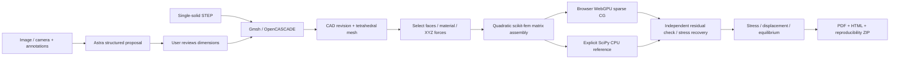

# Architecture and data flow

The React workspace holds a reviewable design draft. Edits invalidate the current result; geometry edits require a rebuild before the simulation can run. The server owns immutable model and run artifacts. A study snapshot references those artifacts and preserves the image, annotations, chat and simulation draft together.

`backend/schemas.py` is the input boundary. All mechanical numeric values reject NaN/Infinity, and geometry/load/material ranges are bounded. Astra output is JSON schema constrained, then revalidated through the same geometry schema. It produces parameters and ordered boolean primitives; the application executes fixed, checked modelling code.

`geometry.py` creates one OpenCASCADE solid or reads STEP, creates a linear tetrahedral geometry mesh and records the triangle membership of every CAD face. The solver upgrades displacement interpolation to P2 through scikit-fem. Face loads and constraints are selected by CAD face ID bound to the model revision. Faces are reselected after every rebuild, even if the mesher happens to reuse a numeric ID.

`solver.py` maps CAD triangles to mesh facets. For each force it computes the discrete face area and integrates a constant traction, ensuring the requested total force is preserved. Dirichlet constraints include vertex and quadratic edge DOFs. The solution checks free-DOF residuals and computes all fixed-DOF reactions and moment balance. It writes full solution arrays and separately produces vertex samples for the viewer.

`jobs.py` keeps a bounded worker queue and runs meshing, solving, and Astra in child processes. The server remains responsive; job timeout terminates its process group. Completed job/result JSON is written atomically. The frontend polls one job ID. Interrupted server restarts do not yet reconnect an in-flight browser request; completed immutable artifacts remain on disk.

`report.py` reads only the stored result and its corresponding model, never the current UI draft. It produces an independent vector stress view, records force definition, constraints, material, dimensions, solver versions and hashes, and builds a self-contained archive. The snapshot can be re-solved with `reproduce.py` using the same mesh.

Current limits include one homogeneous connected body, predefined or box/cylinder CSG proposals, one active reference per study, fixed supports only, no CAD fillet UI, no general photogrammetry, and no physical-material calibration. Camera access depends on the browser and hardware. The optional Astra service is not open source.

The default GPU route prepares an immutable analysis snapshot, transfers a CSR sparse matrix and load vector, and solves on the browser's hardware WebGPU adapter. Symmetric Jacobi scaling and float64 browser residual refinement correct float32 GPU drift. No result is accepted until the backend reconstructs the system from the stored mesh/setup and verifies a relative residual below 1e-7. Reported adapter information is browser-provided; the numerical check is independent. Unavailable hardware and device/precision failures produce errors, never a silent CPU substitution. `frontend/src/gpu.ts` contains the WGSL compute kernels and orchestration. See `SITES-PUBLISHING-PLAN.md` for the hosted execution boundary.
